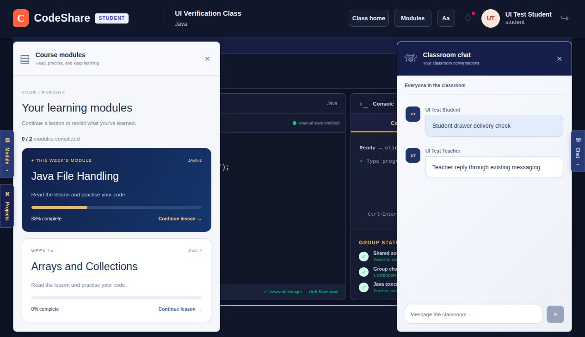
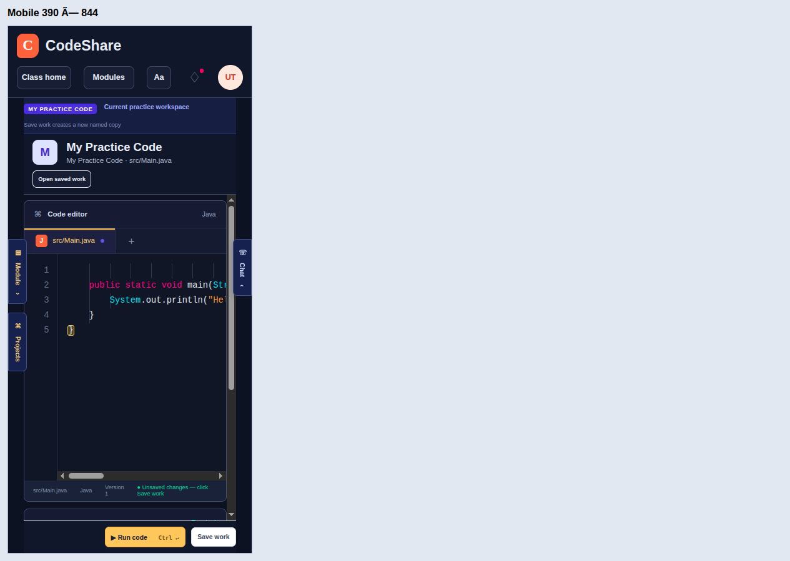

# Classroom Figma UI verification — 2026-10-19

Branch: `codex/classroom-figma-ui`, stacked on `feat/module-redesign-schema` (PR #13).
Teacher approved this as a **workflow change**, retaining the existing top bar, the existing
messaging system on the right and the module browser on the left.

## Results and limits

- PASS — `npm run build:all`: final Next.js and backend builds completed.
- PASS — `npm run lint`: exit 0, **0 errors, 8 existing warnings** (image-element and existing
  live-effect dependency warnings). These warnings remain; they are not silently treated as clean.
- PASS — `npm test`: **64 tests passed, 0 failed, 0 skipped** against local Docker Supabase.
- PASS — `npm run classroom:offline -- --build-only`: local services and offline build completed.
  The built app was served separately on port 3012 with local Supabase and laptop Java execution,
  leaving the user's existing port-3000 server alone.
- NOT VERIFIED — hosted services/deployment, a physical phone, and a second physical LAN device.
- NOT VERIFIED — the unchanged **Save work** naming dialog: this in-app browser reports
  `prompt() is not supported.` Clicking it reached that limitation. File-save route checks in the
  integration suite passed; this is not a claim that the naming dialog was tested end to end.
- NOT VERIFIED — wide-desktop **Pin/Unpin** interaction: the 1600-pixel iframe loaded, but the
  browser's iframe focus/click controls could not activate its controls. Initial drawer markup
  is covered by component tests. Reviewer should click Pin/Unpin on a normal wide desktop.

## Real-app checks

All people and classes used below were isolated local test fixtures, not real student data.

- PASS — Student and teacher class home still open; module upload, roster and availability
  controls remain available. The classroom retains the existing top bar and account/display controls.
- PASS — Left Modules opens the real catalog. Weekly pick is first, real saved progress is shown.
  During an individual live activity the other module card becomes disabled; no invented lock rule.
- PASS — Module **Run & check** executed Java and printed `1`, `2`, `3`, then showed Passed.
  Checking the exit slip saved progress; reopening the drawer showed **33%**.
- PASS — Main workspace **Run code** executed laptop Java and printed `Hello, CodeShare!`.
- PASS — Student sent with **Send message**; teacher received it. Teacher replied using Enter;
  student received it live. These are the existing message route and private live channels.
- PASS — Teacher **Mute students** disabled the student's input; **Unmute students** enabled it.
- PASS — Individual activity: teacher selected the student's workspace and received a private
  drawer message. Teacher demo chat stayed disabled until a student was selected.
- PASS — Group activity: teacher selected Groups and received the student's group drawer message.
  The existing leader-voting prompt, student list and activity controls remained reachable.
- PASS — The Console stays independent of chat. Both drawer close controls work; Escape from a
  drawer closes it and restores focus to its toggle. Student Projects and teacher Students /
  projects expose the existing sidebar controls.
- PASS — At 390 × 844 and 115% text size, the real app was exercised inside a local fixed-width
  iframe. Modules opened from the keyboard and Escape returned focus to Modules. The page width
  measured **390**, with **scrollWidth 390** after the phone-header correction (before: 471).
  The same header controls wrap into two rows on phones. The desktop top bar keeps its layout.
- PASS — In dark mode, the final chat conversation area and bubbles remain light and readable.
  A student bubble measured background `rgb(228, 237, 250)` and text `rgb(52, 68, 95)`; before the
  fix bubbles were `rgb(37, 48, 71)` with the same dark text. The final screenshot shows both
  teacher and student messages and the unchanged dark top bar.

The browser's viewport override returned without changing `innerWidth` (stayed 1280), so real
390-pixel and 1600-pixel iframe layouts were used instead. Iframe click/focus limitations affected
wide pin verification; keyboard navigation worked for the phone drawer check. The native app was
also checked directly at its actual 1280-pixel width.

## Regression proof

- Catalog lock: temporarily replaced the card's disabled guard with `false`. The named live-lock
  test failed; restoring the guard made all focused checks pass.
- CKB-028: before the fix, a browser round trip between lessons reported
  `draftRetainedBeforeFix: false`. After keeping inactive lesson/task editors mounted, the same
  round trip reported `draftRetainedAfterFix: true`. Restoring the filtering implementation also
  made the automated draft-preservation test fail; restoring the fix passed.
- CKB-029 and CKB-030: failing CSS geometry/computed-color measurements are recorded above and in
  their numbered cases. The final real-browser measurements and screenshots passed. There is no
  automated CSS layout runner in this repository; server rendering cannot measure those styles.

## Test levels

`tests/classroom-ui.test.mjs` renders the real React card, drawer and lesson components on their
own. It checks saved progress, actual lock/weekly flags, teacher display, hidden panels and the
presence of inactive editors. It does not pretend to test live networking or browser CSS.

The route/database/live-channel test files below go through the real shared server handlers and
local Supabase, including permissions and saves. Pure schema, router, preview and live-invitation
rule tests exercise their own modules. The real-browser scenarios above cover the combined app.
There is no standalone browser test runner installed; those checks were performed through the
connected browser and their results are recorded here.

## Automated results by file

Command: `npm test`. Each line below retains the runner's pass mark and test name.


### tests/api-router.test.mjs

```text
✔ router: path parameters, query, cookies, and JSON body reach the handler (134.83411ms)
✔ router: middleware passes on with next(), stops by responding, and next(error) reaches the error handler (6.13821ms)
✔ router: cookies, 204, unknown routes, bad JSON, and size limits (84.235364ms)
✔ router: the larger JSON body cap is scoped to the module-upload route, not every route (28.983999ms)
✔ routes: register, stay signed in with the cookie, get a live pass, sign out (669.898731ms)
✔ routes: a chat message's live signal finishes sending before the reply (CKB-006) (604.387968ms)
```


### tests/classroom-ui.test.mjs

```text
✔ module catalog: displays saved progress and distinguishes continuing from reviewing (13.481588ms)
✔ module catalog: the server's live lock disables opening and only the weekly pick gets its badge (2.610029ms)
✔ module catalog: teacher browsing never invents student progress (0.412706ms)
✔ workspace drawers: closed panels hide their controls and the two panels have separate accessible identities (2.503739ms)
✔ module pages: inactive lessons and task editors stay mounted so navigation cannot discard drafts (5.881438ms)
```


### tests/course-module-schema.test.mjs

```text
✔ course module schema: accepts a module matching docs/course-format.md (16.775144ms)
✔ course module schema: rejects a step missing expectedOutput (0.759102ms)
✔ course module schema: rejects an unknown course (0.517545ms)
✔ course module schema: rejects the wrong format tag (0.396194ms)
✔ course module schema: rejects a step id reused by another lesson's step (CKB-007's bug class, reachable at upload) (2.900304ms)
✔ course module schema: rejects a step id that collides with an exit slip's id (0.545511ms)
✔ course module schema: rejects a java step file path that /api/execute could never run (a space) (0.497774ms)
✔ course module schema: rejects a java step file path over /api/execute's 160-character cap (0.865914ms)
✔ course module schema: rejects an unrunnable .java performance-task file path (0.922129ms)
✔ course module schema: rejects duplicate lesson ids before they can share an availability switch (CKB-019) (0.832281ms)
✔ course module schema: accepts a module with no step `part` fields, unchanged (backward compatible) (0.396491ms)
✔ course module schema: accepts a step with a `part` title, including one shared across two lessons (0.35056ms)
✔ course module schema: rejects an empty `part` title (1.409671ms)
```


### tests/course-modules.test.mjs

```text
✔ course modules: teacher uploads, class members read, only the teacher may upload or delete (1791.909584ms)
```


### tests/kb-search.test.mjs

```text
✔ kb:search finds the matching bug record first (88.656064ms)
✔ kb:search says so when nothing matches (63.205947ms)
```


### tests/landing-pages.test.mjs

```text
✔ landing pages: class roster, a student's own module summary, and a teacher's view of a student's progress (1920.638717ms)
✔ class list and creation: a teacher creates classes, a student joins one, and one class's workspace never bleeds into another's (831.784909ms)
```


### tests/live-classes.test.mjs

```text
✔ live invitations: all live classes are offered, dismissal hides only that session, and a new activity invites again (4.336257ms)
✔ live invitations: refresh preserves dismissal, ending a session clears it, and a stopped presentation can invite again (0.642439ms)
✔ live invitations: receive-only listeners refresh on start, stop, and reconnect; cleanup removes their channels and ignores late events (1.383095ms)
✔ live invitations: entering or leaving the workspace waits for old channels to close before reusing their topics (115.000347ms)
```


### tests/module-availability.test.mjs

```text
✔ module availability: unknown modules and step ids cannot create progress (CKB-018) (1769.658758ms)
✔ module availability migration: preserves existing content and work, opens existing modules, defaults new uploads closed, and safely reruns (743.116933ms)
✔ module availability: new modules withhold closed content and reject direct progress writes; only the class teacher can open them (824.413864ms)
✔ module availability: closing and reopening preserves work and the full-module meter; reupload preserves settings and new lessons start closed (820.0405ms)
✔ module availability: the same module in two classes has independent switches, and concurrent teacher edits keep both changes (704.878641ms)
✔ module availability: modules without a performance task reject its switch and submission (624.13777ms)
```


### tests/module-progress.test.mjs

```text
✔ module progress: step checklist, exit slip, and both performance-task versions (new feature, no prior CKB) (1579.326357ms)
✔ module progress: two simultaneous first touches of a module don't 500 (write race) (322.358622ms)
✔ module progress: a module in two classrooms doesn't share one student's progress (classroom scoping) (525.816763ms)
✔ module progress: two simultaneous performance-task submissions don't lose one (write race) (350.379166ms)
```


### tests/module-weekly-active.test.mjs

```text
✔ module weekly active + shared project: pick, lock, and project file round-trip (1655.159937ms)
```


### tests/realtime.test.mjs

```text
✔ realtime: an unrelated topic's subscriber never waits on another topic's pending removal (54.292097ms)
✔ realtime: resubscribing the same topic waits for its own pending removal to finish first (CKB-017) (112.565388ms)
✔ realtime: signing out clears pending cleanup so the next sign-in's subscriber never waits on the discarded client's teardown (52.2837ms)
✔ offline: classroom devices reach local Supabase through the laptop's address (6.001061ms)
✔ throttle sends at most once per interval and never drops the newest value (84.885892ms)
✔ channel rules: members join, outsiders are refused, only the teacher broadcasts to the class (15536.238293ms)
✔ browser pass cannot read tables directly (4.671811ms)
```


### tests/teacher-web-projects.test.mjs

```text
✔ teacher web projects: lists every personal web project for the selected student and class, and reads saved files on demand (2293.043564ms)
✔ teacher web projects: only the owning teacher reads a current class member's projects; guesses and write methods are refused (1208.154358ms)
✔ teacher web projects: empty lists and files are readable, repeated reads never save, and a student's save appears on refresh (1141.157085ms)
✔ teacher web preview: blocks network resources before student code while preserving the doctype and console line map (1.808865ms)
✔ teacher web preview: allows eval/Function so a saved eval()-based calculator behaves the same as it does for the student (0.127161ms)
✔ teacher web preview: headless pages retain console locations and missing HTML keeps its existing warning (0.19086ms)
```


### tests/web-workspace.test.mjs

```text
✔ inlines linked CSS and JavaScript, no external loads (3.867337ms)
✔ maps document lines back to the student's file and line (0.699917ms)
✔ capture script sits on the <head> line and does not shift lines (0.394351ms)
✔ works without <head>, and warns about missing files (0.554158ms)
✔ a </script> inside JavaScript cannot break out of the inlined script (0.292629ms)
✔ no index.html gives a friendly message (0.229391ms)
✔ file names must fit the project language (0.524741ms)
```


## Focused command and screenshots

`node tests/classroom-ui.test.mjs`: **5 passed, 0 failed/skipped**. These same five tests are
included in the full-suite results above; they are not five additional tests.




