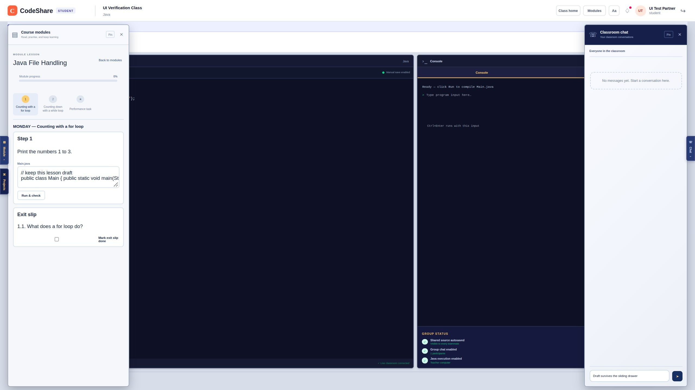

# Drawer slide animation — verification, 2026-10-19

Implementation: `d072aa1`, [PR #15](https://github.com/SirNeo-Coder/JavaShare/pull/15).
Branch: `codex/drawer-slide-animation`, based on merged main (`667186c`). The teacher approved the
proposal as an **adjustment**: Modules / Projects slide from the left, Chat from the right,
250 ms opening and closing, existing content and controls preserved.

## Results and limits

- PASS — `npm run classroom:offline -- --build-only`: local Docker Supabase and the complete
  `npm run build:all` (Next.js + backend) build completed.
- PASS — `npm run lint`: **0 errors, 8 existing warnings** (image elements and the existing live
  effect dependencies). Warnings remain; this is not a claim of warning-free lint.
- PASS — `npm test`: **64 passed, 0 failures, 0 skipped**, using local Supabase.
- PASS — `node tests/classroom-ui.test.mjs`: **5 passed**, including the updated drawer regression.
- PASS — Real browser on localhost:3000: intermediate positions measured for opening and closing,
  chat and module drafts retained, rapid reversals correct, Projects animation, Escape focus,
  closed controls absent from accessibility state, and pin spacing preserved.
- PARTIALLY VERIFIED — reduced motion. The delivered browser stylesheet contains the
  `prefers-reduced-motion: reduce` rule setting drawer transitions to `none`. The test browser's
  preference was false, and its tools expose no media-preference override, so reduced mode was
  **not forced end to end**. This remains a manual OS/browser preference check.
- NOT VERIFIED — physical phones, a second physical LAN device, or hosted deployment. The change
  has no routes, database changes, dependencies or external assets.

## Before / after and regression proof

Before the fix the real closed module drawer measured `hidden: true`, `display: none`, duration
`0s`. Its outer panel could not animate. The focused regression failed against that behavior.

After the fix the panel remains `display: grid`; it uses `data-open`, `inert`, `aria-hidden`, CSS
translation and delayed visibility. Closed controls become inert immediately even while their
panel is still visibly sliding out. Opening/closing needs no timer or extra rendering state.

To prove the regression, temporarily restored the old `hidden={!open}` behavior in the component,
ran `node tests/classroom-ui.test.mjs`, and got **4 passed, 1 failed**, specifically:

```text
✖ workspace drawers: closed panels stay mounted but inaccessible so closing can animate
```

Restored the fix and reran: **5 passed, 0 failed**. The final application source is restored and
matches the successful build. The unit check covers rendered/accessibility state; the browser
measurements below prove actual CSS movement, which server rendering cannot measure.

## Real browser measurements

The browser sampled the actual computed transform repeatedly during each 250 ms transition.
Negative x is off the left edge; positive x is off the right edge; zero is fully open. These are
observed intermediate positions rather than animation declarations alone.

| Panel and direction | Sampled translateX values in CSS pixels |
| --- | --- |
| Modules opening | -422.0, -272.5, -210.3, -159.4, -119.1, -87.8, -87.8 |
| Modules closing | 0.0, 0.0, -149.3, -149.4, -211.7, -262.6 |
| Chat opening | 362.0, 295.7, 233.9, 180.4, 136.7, 102.2, 102.2 |
| Chat closing | 0.0, 66.4, 128.1, 225.2, 259.8, 286.7 |
| Projects opening | -342.0, -279.2, -220.9, -170.4, -129.2, -96.6 |

Checks through the real app:

- PASS — Module and chat controls were opened using their visible toggles. Position and opacity
  changed progressively in the expected direction; close controls and toggles slid them back out.
- PASS — Escape from chat closed it and returned focus to Chat. While closing, it already had
  `inert` and `aria-hidden=true`, but stayed rendered for the slide-out.
- PASS — A chat draft survived close/reopen. A typed lesson comment survived closing and reopening
  the module drawer, using the existing module editor. No new message or module system.
- PASS — Six successive chat toggles produced false / true / false / true / false / true, with
  inert exactly matching the closed state, and the chat draft still intact.
- PASS — Projects used its left-side animation and still showed the existing project controls.
- PASS — At a real 2560-pixel browser viewport, pinned left spacing was 402px, cleared to 0 on
  close, and returned to 402px on reopen. Right spacing was 342px, cleared to 0, and returned to
  342px. Unpin remained available. This also verifies the changed pin selectors.
- PASS — With both drawers off-screen, page width and scrollWidth were both 2560; translating the
  right panel did not widen the page.
- PASS — The existing offline supervisor restarted only its Next.js worker with the new build.
  `/api/health` returned `mode: supabase-local`, `connected: true`, `repositoryStatus: ready`.
  Database and sign-in settings were preserved; the existing sign-in survived the restart.

The available browser DOM interface does not expose Element.getAnimations(), so computed-style
samples were used. Initial checks in the visible localhost tab had inconsistent native target/focus behavior;
final deterministic checks used a separate 127.0.0.1 session and generated fixture accounts. Neither session used real student data.

## Recheck manually

1. Open localhost:3000, refresh, sign in and choose Open class → Enter classroom.
2. Open/close Module and Projects. They should slide from/to the left; Chat should slide from/to
   the right. Click twice quickly to reverse the direction.
3. Type a chat draft, close and reopen Chat: the draft stays. Repeat with a lesson editor.
4. Close a drawer with Escape. Confirm its toggle gets focus and closed controls are not reachable.
5. On a wide desktop, pin each drawer, close/reopen it and unpin. The reserved workspace follows
   only the open pinned drawer.
6. Enable the OS/browser reduced-motion preference: drawers should switch immediately. Restore
   the preference afterward. Step 6 was not forced by this browser tool, as noted above.

## Automated results by file

Command: `npm test`. Exact runner pass marks and names follow. The five focused component checks
are part of this full suite, not five additional tests. Pure React/schema/routing/preview tests
check rules on their own; route/database/live-channel checks use the real shared backend and
local Supabase. The real-browser checks above cover combined app behavior.


### tests/api-router.test.mjs

```text
✔ router: path parameters, query, cookies, and JSON body reach the handler (43.083597ms)
✔ router: middleware passes on with next(), stops by responding, and next(error) reaches the error handler (8.241644ms)
✔ router: cookies, 204, unknown routes, bad JSON, and size limits (30.033819ms)
✔ router: the larger JSON body cap is scoped to the module-upload route, not every route (12.121536ms)
✔ routes: register, stay signed in with the cookie, get a live pass, sign out (423.050472ms)
✔ routes: a chat message's live signal finishes sending before the reply (CKB-006) (589.699542ms)
```


### tests/classroom-ui.test.mjs

```text
✔ module catalog: displays saved progress and distinguishes continuing from reviewing (14.758919ms)
✔ module catalog: the server's live lock disables opening and only the weekly pick gets its badge (2.854057ms)
✔ module catalog: teacher browsing never invents student progress (0.620475ms)
✔ workspace drawers: closed panels stay mounted but inaccessible so closing can animate (3.687879ms)
✔ module pages: inactive lessons and task editors stay mounted so navigation cannot discard drafts (6.984237ms)
```


### tests/course-module-schema.test.mjs

```text
✔ course module schema: accepts a module matching docs/course-format.md (107.217124ms)
✔ course module schema: rejects a step missing expectedOutput (0.954612ms)
✔ course module schema: rejects an unknown course (1.979468ms)
✔ course module schema: rejects the wrong format tag (0.359072ms)
✔ course module schema: rejects a step id reused by another lesson's step (CKB-007's bug class, reachable at upload) (0.634439ms)
✔ course module schema: rejects a step id that collides with an exit slip's id (0.63387ms)
✔ course module schema: rejects a java step file path that /api/execute could never run (a space) (0.376994ms)
✔ course module schema: rejects a java step file path over /api/execute's 160-character cap (0.437829ms)
✔ course module schema: rejects an unrunnable .java performance-task file path (0.402528ms)
✔ course module schema: rejects duplicate lesson ids before they can share an availability switch (CKB-019) (0.59527ms)
✔ course module schema: accepts a module with no step `part` fields, unchanged (backward compatible) (0.345112ms)
✔ course module schema: accepts a step with a `part` title, including one shared across two lessons (0.831106ms)
✔ course module schema: rejects an empty `part` title (0.510457ms)
```


### tests/course-modules.test.mjs

```text
✔ course modules: teacher uploads, class members read, only the teacher may upload or delete (1357.811081ms)
```


### tests/kb-search.test.mjs

```text
✔ kb:search finds the matching bug record first (84.878009ms)
✔ kb:search says so when nothing matches (57.145493ms)
```


### tests/landing-pages.test.mjs

```text
✔ landing pages: class roster, a student's own module summary, and a teacher's view of a student's progress (1553.166152ms)
✔ class list and creation: a teacher creates classes, a student joins one, and one class's workspace never bleeds into another's (752.048414ms)
```


### tests/live-classes.test.mjs

```text
✔ live invitations: all live classes are offered, dismissal hides only that session, and a new activity invites again (2.239557ms)
✔ live invitations: refresh preserves dismissal, ending a session clears it, and a stopped presentation can invite again (0.455564ms)
✔ live invitations: receive-only listeners refresh on start, stop, and reconnect; cleanup removes their channels and ignores late events (1.132525ms)
✔ live invitations: entering or leaving the workspace waits for old channels to close before reusing their topics (104.538688ms)
```


### tests/module-availability.test.mjs

```text
✔ module availability: unknown modules and step ids cannot create progress (CKB-018) (1319.473881ms)
✔ module availability migration: preserves existing content and work, opens existing modules, defaults new uploads closed, and safely reruns (663.231133ms)
✔ module availability: new modules withhold closed content and reject direct progress writes; only the class teacher can open them (768.198981ms)
✔ module availability: closing and reopening preserves work and the full-module meter; reupload preserves settings and new lessons start closed (816.120136ms)
✔ module availability: the same module in two classes has independent switches, and concurrent teacher edits keep both changes (780.288217ms)
✔ module availability: modules without a performance task reject its switch and submission (669.837386ms)
```


### tests/module-progress.test.mjs

```text
✔ module progress: step checklist, exit slip, and both performance-task versions (new feature, no prior CKB) (1140.637883ms)
✔ module progress: two simultaneous first touches of a module don't 500 (write race) (332.917444ms)
✔ module progress: a module in two classrooms doesn't share one student's progress (classroom scoping) (529.81832ms)
✔ module progress: two simultaneous performance-task submissions don't lose one (write race) (307.367673ms)
```


### tests/module-weekly-active.test.mjs

```text
✔ module weekly active + shared project: pick, lock, and project file round-trip (1288.258672ms)
```


### tests/realtime.test.mjs

```text
✔ realtime: an unrelated topic's subscriber never waits on another topic's pending removal (53.013021ms)
✔ realtime: resubscribing the same topic waits for its own pending removal to finish first (CKB-017) (101.529878ms)
✔ realtime: signing out clears pending cleanup so the next sign-in's subscriber never waits on the discarded client's teardown (50.816403ms)
✔ offline: classroom devices reach local Supabase through the laptop's address (0.586594ms)
✔ throttle sends at most once per interval and never drops the newest value (82.294702ms)
✔ channel rules: members join, outsiders are refused, only the teacher broadcasts to the class (15278.518159ms)
✔ browser pass cannot read tables directly (5.129999ms)
```


### tests/teacher-web-projects.test.mjs

```text
✔ teacher web projects: lists every personal web project for the selected student and class, and reads saved files on demand (1886.347191ms)
✔ teacher web projects: only the owning teacher reads a current class member's projects; guesses and write methods are refused (1115.961818ms)
✔ teacher web projects: empty lists and files are readable, repeated reads never save, and a student's save appears on refresh (1259.551679ms)
✔ teacher web preview: blocks network resources before student code while preserving the doctype and console line map (2.164148ms)
✔ teacher web preview: allows eval/Function so a saved eval()-based calculator behaves the same as it does for the student (0.238092ms)
✔ teacher web preview: headless pages retain console locations and missing HTML keeps its existing warning (0.30824ms)
```


### tests/web-workspace.test.mjs

```text
✔ inlines linked CSS and JavaScript, no external loads (7.793313ms)
✔ maps document lines back to the student's file and line (0.868193ms)
✔ capture script sits on the <head> line and does not shift lines (0.403873ms)
✔ works without <head>, and warns about missing files (0.321126ms)
✔ a </script> inside JavaScript cannot break out of the inlined script (0.35428ms)
✔ no index.html gives a friendly message (0.204218ms)
✔ file names must fit the project language (4.248088ms)
```


## Cleanup

Generated test sessions signed out; the isolated test class and all three generated accounts were
removed from local Supabase. The ordinary localhost:3000 server remains running with this build.

## Screenshot

Settled classroom after both drawers opened, using only generated local test data. Motion itself
is evidenced by the computed-position samples above, not by this still image.


