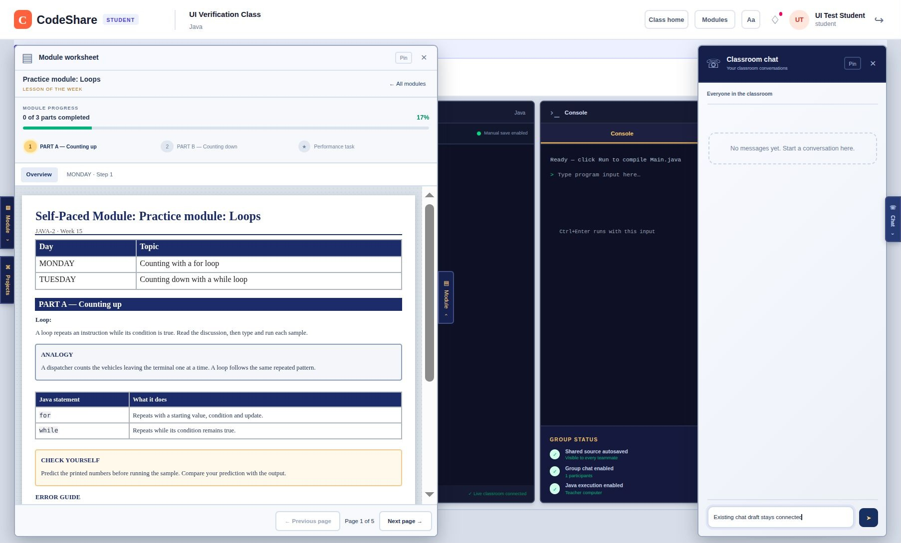
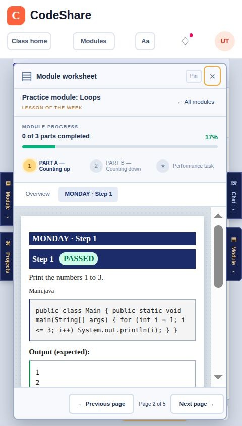
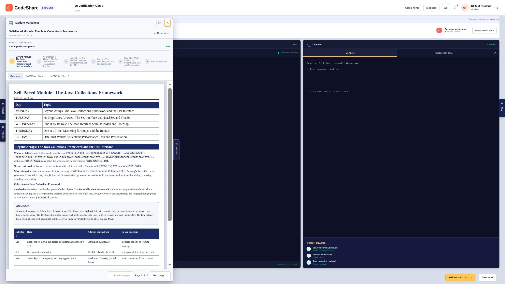
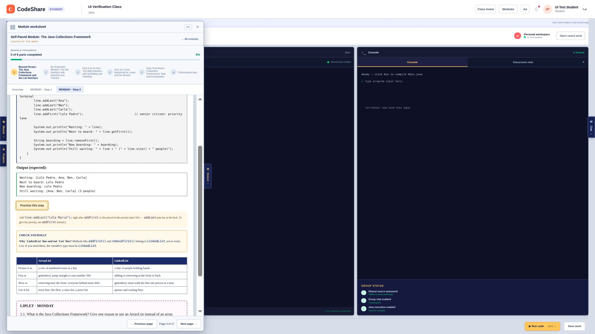

# Printed module worksheet — verification, 2026-10-20

Implementation: `9b538d5`, [PR #16](https://github.com/SirNeo-Coder/JavaShare/pull/16), stacked on PR #15.

Branch: `codex/printed-module-worksheet`, based on drawer-animation PR #15 (`3990646`).
Teacher explicitly approved this proposal as a **workflow change** after supplying worksheet
screenshots and a local Collections Framework PDF as a visual reference.

## Results and limits

- KNOWN FAILURE — the supplied JSON's Step 1 cannot find Vehicle/Jeepney/Tricycle/Bus because
  the existing student response/step runner omits module-level starter files (CKB-038). Step 2
  runs and passes. A narrow server-response/execution compatibility proposal is awaiting teacher
  approval; this UI PR does not claim that all eleven supplied samples run successfully.

- PASS — `npm run classroom:offline -- --build-only`, including `npm run build:all` (Next.js and backend).
- PASS — `npm run lint`: 0 errors, **8 existing warnings** (image elements and live effect dependencies).
- PASS — `npm test`: **69 passed, 0 failed, 0 skipped** against local Docker Supabase.
- PASS — `node tests/classroom-ui.test.mjs`: **10 passed**, included in the full suite above.
- PASS — real offline browser: separate catalog/worksheet, structured paper content, part/page
  navigation, real laptop javac output, saved progress, retained draft, native pointer hover,
  inside/leave behavior, Pin, keyboard opening/closing, Escape return focus, narrow layout and
  light/dark paper contrast. Existing chat opens beside the worksheet with its existing draft.
- PARTIALLY VERIFIED — reduced motion: actual delivered styles disable drawer and ear transitions
  under `prefers-reduced-motion: reduce`. Browser preference was false; tools expose no override,
  so switching that preference remains a manual check.
- NOT VERIFIED — physical touchscreen, phone, second LAN device or hosted deployment. Narrow
  browser check measured **480 CSS pixels**; this browser clamps the smaller requested size.
  Do not treat this as proof of 390px or a physical touch gesture.
- Scope: PDF used as appearance reference only. It was not converted, uploaded to any class or
  bundled in the app. The first checks used a disposable Loops module; the additional October 20 screenshots and
  checks use the teacher's exact uploaded JSON, unchanged. No real classroom was modified.

## Regression evidence

- CKB-028 and CKB-031's existing draft-mounting and drawer rendering regressions were run before
  implementation and remained passing afterward. Their causes guided preservation, not diagnosis
  of unrelated symptoms.
- **CKB-032:** the former non-step renderer only showed term/markdown, omitting tables/error guides.
  Temporarily disabling the new table branch produced **7 passes, 2 failures**, specifically the
  supplied-content table test and worksheet task-rubric check. Restoring the renderer passed **9/9**.
  This is an explicit mutation of the omission, not a claim to restore every line of the old UI.
- **CKB-033:** before the focus fix, Escape from an editor in a hover-opened worksheet closed the
  drawer but left no labelled return target. Afterward, Escape from a focused Overview control
  inside a hover-opened worksheet closed it and focused **Module worksheet**. Hover opening itself
  did not steal focus. Native browser check; server-render unit tests cannot exercise focus effects.
- **CKB-034:** before clipping fix, classroom left was 0 and worksheet group left -378px, although
  its open transform was zero. After narrowing with the ear focused and keyboard reopening:
  classroom/group left **0**, container scrollLeft **0**, overflow **clip**, drawer left **25.28px**,
  right **450.06px**, width **424.78px**, viewport/page scrollWidth **480px**. Paper remains scrollable.
  This was checked through actual layout and focus, not a CSS-source string assertion.

- **CKB-035:** after opening a previously closed lesson via the existing teacher route, returning
  to All modules and selecting the same card still displayed Not open yet in the first build.
  The final reader tracks explicit catalog visits. The browser recheck closes an open lesson via
  the teacher route, then selects the same card again and sees the newly closed page. Ear toggles
  preserve the same visit; explicit card reselection reloads content and resets its draft.

## Checks through the real app

- Open class → Enter classroom → Module → module card opened a **separate** wide worksheet.
  The original catalog stayed available through **All modules**. Selected module and page stayed
  mounted while the worksheet closed/reopened. The existing top bar remained present.
- Overview displayed the supplied schedule, definition, labelled analogy, table, note and error
  guide. Step page displayed the exact fixture source and expected output. Parts and page counts
  came from that fixture; no screenshot's example 60% value was hard-coded.
- **Practise this step → Run & check** ran Java on the offline laptop and produced `1 / 2 / 3` on
  separate lines, **Passed**, and saved **17%** progress. That percentage survived the server reload.
- A comment typed in the practice editor survived switching to another part and back, and closing
  and reopening. Reloading or selecting a different module is outside this in-memory draft promise.
- Native pointer movement used the browser's drag input from empty space to the ear (the mouse
  down started outside the button, so no ear click was submitted). Hover opened, movement into
  the worksheet kept it open, movement out closed it. Pin kept a hover preview open after leaving;
  wide desktop space reserved **752 CSS pixels**. A small retained hit area prevents the moving ear
  from disappearing out from under its opening pointer.
- Keyboard Enter activated the ear and opened the worksheet. Escape from inside closed it and
  restored the reachable Module ear. Closed drawer controls use inert/aria-hidden immediately.
- Narrow browser layout regression details appear above. Paper, code and tables scroll inside
  the reader, while the classroom stays fixed horizontally.
- Switching to dark appearance kept paper white (`rgb(255,255,255)`), text dark (`rgb(34,34,34)`),
  and navy-heading text white. Restored the original light appearance and normal viewport.
- The fixture's closed performance task and its second module's closed lessons displayed **Not
  open yet**; the visible closed article contained no code. The existing server redaction is unchanged.
- Existing **Chat** opened alongside the worksheet; its message input accepted a draft. No second
  chat system or message handler was created. No test message was sent to anyone.
- Existing offline supervisor restarted only the Next.js worker for the built app; final
  `/api/health` reported `supabase-local`, connected true, repository ready. No hosted setting changed.

## Recheck manually

1. Refresh localhost:3000, sign in, Open class → Enter classroom → Module, and choose a module.
2. Check the printed paper, named parts, Overview/step tabs and Previous/Next page controls.
3. Practise a step, run it, then type a draft and switch parts/close/reopen. Confirm the draft stays.
4. Close the worksheet. Hover its additional Module ear, enter the paper, and then leave. Try Pin.
5. Try keyboard Enter and Escape. Check focus returns to Module and hidden controls are unreachable.
6. Open a closed lesson/task and confirm Not open yet. Open Chat alongside the paper.
7. Toggle reduced motion and check instant open/close. Also check a physical phone/touchscreen;
   these two device/preference checks were not completed by the browser tool.

## Automated results by file

Command: `npm test`. Exact runner marks and names are grouped below. The ten focused component
checks belong to this same 69-test suite, not additional tests. React/grouping/schema/router and
preview checks test rules in isolation; module/landing/live-class/teacher-project routes and
Realtime permission checks go through the real HTTP handlers or local Supabase services. Actual
rendering, native pointer input, focus and javac execution were checked separately in the browser
as recorded above; these are not claimed as automated browser tests.

### tests/api-router.test.mjs

```text
✔ router: path parameters, query, cookies, and JSON body reach the handler (95.123599ms)
✔ router: middleware passes on with next(), stops by responding, and next(error) reaches the error handler (3.54548ms)
✔ router: cookies, 204, unknown routes, bad JSON, and size limits (58.516577ms)
✔ router: the larger JSON body cap is scoped to the module-upload route, not every route (18.232936ms)
✔ routes: register, stay signed in with the cookie, get a live pass, sign out (987.418338ms)
✔ routes: a chat message's live signal finishes sending before the reply (CKB-006) (829.775032ms)
```

### tests/classroom-ui.test.mjs

```text
✔ module catalog: displays saved progress and distinguishes continuing from reviewing (32.542993ms)
✔ module catalog: the server's live lock disables opening and only the weekly pick gets its badge (4.334539ms)
✔ module catalog: teacher browsing never invents student progress (0.967635ms)
✔ workspace drawers: closed panels stay mounted but inaccessible so closing can animate (4.700012ms)
✔ module pages: inactive lessons and task editors stay mounted so navigation cannot discard drafts (11.973363ms)
✔ module parts: author grouping spans days and assigns discussion and exit slips exactly once (3.030924ms)
✔ module parts: older lessons and redacted closed lessons retain their own safe pages (1.218119ms)
✔ module paper: tables, analogies, notes and error guides display their actual supplied content safely (4.671135ms)
✔ module worksheet: named parts, real code/output, page controls and hidden practice editors coexist (14.973654ms)
✔ module worksheet: inter-step tables and notes retain the uploaded reading order (17.188952ms)
```

### tests/course-module-schema.test.mjs

```text
✔ course module schema: accepts a module matching docs/course-format.md (27.900444ms)
✔ course module schema: rejects a step missing expectedOutput (1.535451ms)
✔ course module schema: rejects an unknown course (1.217068ms)
✔ course module schema: rejects the wrong format tag (1.851003ms)
✔ course module schema: rejects a step id reused by another lesson's step (CKB-007's bug class, reachable at upload) (5.214992ms)
✔ course module schema: rejects a step id that collides with an exit slip's id (1.736053ms)
✔ course module schema: rejects a java step file path that /api/execute could never run (a space) (1.389419ms)
✔ course module schema: rejects a java step file path over /api/execute's 160-character cap (2.951161ms)
✔ course module schema: rejects an unrunnable .java performance-task file path (2.406509ms)
✔ course module schema: rejects duplicate lesson ids before they can share an availability switch (CKB-019) (1.769674ms)
✔ course module schema: accepts a module with no step `part` fields, unchanged (backward compatible) (1.05184ms)
✔ course module schema: accepts a step with a `part` title, including one shared across two lessons (3.98145ms)
✔ course module schema: rejects an empty `part` title (2.67215ms)
```

### tests/course-modules.test.mjs

```text
✔ course modules: teacher uploads, class members read, only the teacher may upload or delete (2435.882396ms)
```

### tests/kb-search.test.mjs

```text
✔ kb:search finds the matching bug record first (144.165867ms)
✔ kb:search says so when nothing matches (131.794378ms)
```

### tests/landing-pages.test.mjs

```text
✔ landing pages: class roster, a student's own module summary, and a teacher's view of a student's progress (2612.727474ms)
✔ class list and creation: a teacher creates classes, a student joins one, and one class's workspace never bleeds into another's (1192.250765ms)
```

### tests/live-classes.test.mjs

```text
✔ live invitations: all live classes are offered, dismissal hides only that session, and a new activity invites again (3.097731ms)
✔ live invitations: refresh preserves dismissal, ending a session clears it, and a stopped presentation can invite again (0.853792ms)
✔ live invitations: receive-only listeners refresh on start, stop, and reconnect; cleanup removes their channels and ignores late events (2.17452ms)
✔ live invitations: entering or leaving the workspace waits for old channels to close before reusing their topics (132.269768ms)
```

### tests/module-availability.test.mjs

```text
✔ module availability: unknown modules and step ids cannot create progress (CKB-018) (2385.726941ms)
✔ module availability migration: preserves existing content and work, opens existing modules, defaults new uploads closed, and safely reruns (914.111052ms)
✔ module availability: new modules withhold closed content and reject direct progress writes; only the class teacher can open them (1329.606941ms)
✔ module availability: closing and reopening preserves work and the full-module meter; reupload preserves settings and new lessons start closed (1367.746474ms)
✔ module availability: the same module in two classes has independent switches, and concurrent teacher edits keep both changes (1270.673835ms)
✔ module availability: modules without a performance task reject its switch and submission (1081.607372ms)
```

### tests/module-progress.test.mjs

```text
✔ module progress: step checklist, exit slip, and both performance-task versions (new feature, no prior CKB) (2201.107252ms)
✔ module progress: two simultaneous first touches of a module don't 500 (write race) (478.589788ms)
✔ module progress: a module in two classrooms doesn't share one student's progress (classroom scoping) (805.921511ms)
✔ module progress: two simultaneous performance-task submissions don't lose one (write race) (491.894604ms)
```

### tests/module-weekly-active.test.mjs

```text
✔ module weekly active + shared project: pick, lock, and project file round-trip (2258.652534ms)
```

### tests/realtime.test.mjs

```text
✔ realtime: an unrelated topic's subscriber never waits on another topic's pending removal (52.563673ms)
✔ realtime: resubscribing the same topic waits for its own pending removal to finish first (CKB-017) (102.026787ms)
✔ realtime: signing out clears pending cleanup so the next sign-in's subscriber never waits on the discarded client's teardown (51.341732ms)
✔ offline: classroom devices reach local Supabase through the laptop's address (1.241854ms)
✔ throttle sends at most once per interval and never drops the newest value (82.629115ms)
✔ channel rules: members join, outsiders are refused, only the teacher broadcasts to the class (16018.15773ms)
✔ browser pass cannot read tables directly (5.584419ms)
```

### tests/teacher-web-projects.test.mjs

```text
✔ teacher web projects: lists every personal web project for the selected student and class, and reads saved files on demand (3064.496606ms)
✔ teacher web projects: only the owning teacher reads a current class member's projects; guesses and write methods are refused (1989.998103ms)
✔ teacher web projects: empty lists and files are readable, repeated reads never save, and a student's save appears on refresh (1784.966584ms)
✔ teacher web preview: blocks network resources before student code while preserving the doctype and console line map (2.321181ms)
✔ teacher web preview: allows eval/Function so a saved eval()-based calculator behaves the same as it does for the student (0.205346ms)
✔ teacher web preview: headless pages retain console locations and missing HTML keeps its existing warning (0.308324ms)
```

### tests/web-workspace.test.mjs

```text
✔ inlines linked CSS and JavaScript, no external loads (5.775748ms)
✔ maps document lines back to the student's file and line (0.98497ms)
✔ capture script sits on the <head> line and does not shift lines (0.599933ms)
✔ works without <head>, and warns about missing files (1.031045ms)
✔ a </script> inside JavaScript cannot break out of the inlined script (0.618961ms)
✔ no index.html gives a friendly message (2.117372ms)
✔ file names must fit the project language (0.915886ms)
```

## Screenshots

Generated local test content only. The PDF was the visual reference, not a new module import.





## Exact supplied JSON — October 20 follow-up

Source: `/home/ireneo/Documents/Java 2026/Java2_Week_14.codeshare.json`, module `java-2-w14`.
The file validates against the actual upload schema. It has five lessons, eleven steps, and no
explicit step `part` labels, so the existing lesson titles form five groups, plus the separate
Performance task. This creates **17 digital pages**, not 17 printed PDF pages. Its original ids,
text, source files and outputs were not edited.

A local static-render assertion checked all eleven steps' supplied files and expected outputs
against the actual rendered HTML, unchanged. Its block types are text, definition, analogy, table,
note, step and errorGuide. The original JSON was uploaded through the existing route into one
isolated local test class with two generated accounts, and all lessons/task opened there.

- PASS — browser shows the true title, five lesson headings, real tables and 17-page navigation.
- PASS — CKB-037 reading-order regression: restoring collect-all-discussion pagination failed
  exactly its new test (9 pass, 1 fail); restoring correct pagination passed 10/10.
- PASS — method tables and look-closely notes follow Step 1's output; the comparison table and
  Monday liplet follow Step 2. They are not collected ahead of their code in Overview.
- PASS — actual LinkedList Step 2 ran through offline javac, matched its full expected output,
  showed Passed and saved **6%** progress.
- FAIL / KNOWN EXISTING LIMIT — Step 1 printed six javac cannot-find-symbol errors for Vehicle,
  Jeepney, Tricycle and Bus. Those supporting classes exist in module starterFiles but are absent
  from the current student response/step execution request. CKB-038 records the proposed narrow
  compatibility fix and pending scope approval. No sample source was altered to conceal it.
- PASS — CKB-036 integration: opening Projects produced worksheet data-open false, Projects
  data-open true and visible New web project/current-project controls; closing Projects restored
  the same worksheet page and saved result. This completes the previously pending browser check.
- PASS — current full build and lint checks passed; full suite **69/69**, no skips, ten focused
  checks included. Lint retains eight existing warnings.





## Cleanup

The October 20 exact-JSON test session was signed out. Its isolated class and both generated
accounts were removed, and temporary local credential files deleted. The offline classroom
remains running on localhost:3000 with this tested build. No real class data was changed.
